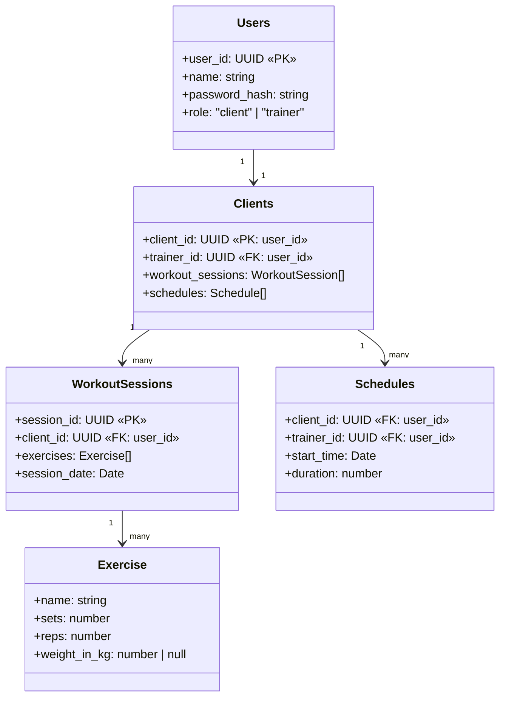

# Project Application Proposal: FitLab
  Canvas group 3
  Alexander Cannuli, Edison Lu, Jiachen Sun, Rayan Maknojia, Ricky Tat

## The Problem

Many fitness trainers currently manage client progress through scattered tools like spreadsheets, messaging apps, and notebooks. This makes it difficult to track a client’s full progress over time, especially when managing multiple clients online or in person. Regular users also often struggle to know what exercises to do, how to track their routine, or how to understand their progress without hiring a trainer.

FitLab makes it easy for users to track their workouts since all information about their fitness routine is stored in one place. Furthermore, FitLab helps trainers make better decisions regarding their clients’ workout history and progress

## Target Audience 
The target audience for FitLab is personal trainers with several clients, people working out at the gym who want to keep a record of their fitness routine, and regular users who need general advice regarding workout and health. FitLab will be useful for those who like a visual representation of progress.

## Scope and Main Features

**User Authentication and Role Management (Assigned to: Alex)**

Users will be able to register, log in, and choose whether they are a client or trainer. The app will support role-based access so trainers and clients see different dashboards.

**Main tasks:**
- User registration and login
- Password hashing
- Role-based dashboard access
- Admin user management

**Fitness Data Tracking (Assigned to: Edison)**

Users will be able to log their workouts, exercises, and fitness progress.

**Main tasks:**
- Add workout logs
- Add exercise details
- View previous history

**Trainer-Client Management/Data Syncup (Assigned to: Jiachen Sun)**

Trainers will be able to manage their clients and access shared client data and clients are able to sync up the data with trainers. This is one of the main features of FitLab.

**Main tasks:**
- Client connection/request system
- View client workout/progress data
- Trainer updates the client data and save the changes in the backend
- Updated data will be applied to Client’s side as well

**Progress Dashboard and Graphs (Assigned to: Rayan Maknojia)**

FitLab will generate visual progress over time dynamically using charts and summaries. 

**Main tasks:**
- Workout progress graphs
- Body measurement or weight progress
- Weekly/monthly summaries
- Client progress dashboard for trainers

**AI Fitness Chatbot (Assigned to: Ricky)**

FitLab will include an AI chatbot that can answer general fitness-related questions. This will be especially useful for regular users who do not currently have a trainer. 

**Main tasks:**
- Chatbot UI
- Third-party AI API integration
- Context-aware recommendations based on user goals and previous progress 
- User profile and workout history analysis for personalized guidance 
- Save optional chat history

## High-Level Architecture

FitLab will use **Stack A: Express + React**.

**Frontend**: React and shadcn/ui as the CSS framework

**Backend**: Node.js + Express.js

**Database**: MongoDB

**Internal service**: A Node.js + Express.js server

**External service**: An AI API like OpenAI API or Gemini API for the chatbot

**Deployment**: The React frontend (served by nginx, which also reverse-proxies `/api`), the Express backend and MongoDB run locally as Docker Compose services.

## Running locally (Docker Compose)

1. Create `backend/.env` from `backend/.env.example`. Inside Compose, set
   `CONNECTION_STRING=mongodb://mongo:27017/fitlab?directConnection=true` and
   `FRONTEND_ORIGIN=http://localhost:8080`, and choose a random `SESSION_SECRET`.
   Fill in `GROQ_API_KEY` (chatbot) and the Gmail values (password reset) if you need those features.
2. Run `docker compose up --build`.
3. Open http://localhost:8080.

## Database Entities and Relationships

Regular users can sign up as a gym client or gym trainer. A trainer can have multiple clients, and clients can only have 1 trainer. A client will store a WorkoutSessions field as an array to record their progress and a Schedules field as an array of times the client is training at the gym.

## Why This Team for This Project

Our team is a good fit for FitLab because the project can be divided into clear features that match different parts of full-stack development. Some members can focus on frontend pages and user experience, while others can focus on backend APIs, database design, authentication, deployment, and external API integration. 

Each main feature is also large enough to count as one feature per member, which helps keep the work balanced across the group. 
**Team Member Focus Areas** 
**Alexander Cannuli**: User Authentication and Role Management
**Edison Lu**: Fitness data tracking and workout session structure 
**Jiachen Sun**: Trainer-Client Management
**Rayan Maknojia**: Progress Dashboard and Graphs 
**Ricky Tat**: AI fitness chatbot and external API integration 

## Framework Justification

**Why two apps over one**

This app can potentially have multiple frontends (for example, a mobile frontend as clients may want to record their progress immediately at the gym). In that case, our Express API can still work for the mobile frontend.

We also value separation of concerns. Our backend will be complex, involving data syncing, persistent real-time connections, background processing, and potentially more. We find a separate backend easier to maintain and manage.

**Repo structure**

We plan to work in 1 repo that contains a frontend folder with all our React app code, and a backend folder with our Express.js and our Node.js server code. Doing so allows teammates to focus on only 1 repo while still separating frontend work and backend work.

**How the two apps talk**

The React frontend will communicate with our Express backend through REST API requests. The front end runs on 1 port and the backend on another port. They run in 2 different Docker containers orchestrated by Docker Compose. Nginx will act as our reverse proxy.

**API style**

We’ll use the standard REST API style as it’s the one we all have the most experience with.
REST API allows FitLab to manage resources such as users, workouts, and progress records through a consistent interface. This supports trainers and clients in accessing and updating data efficiently.
